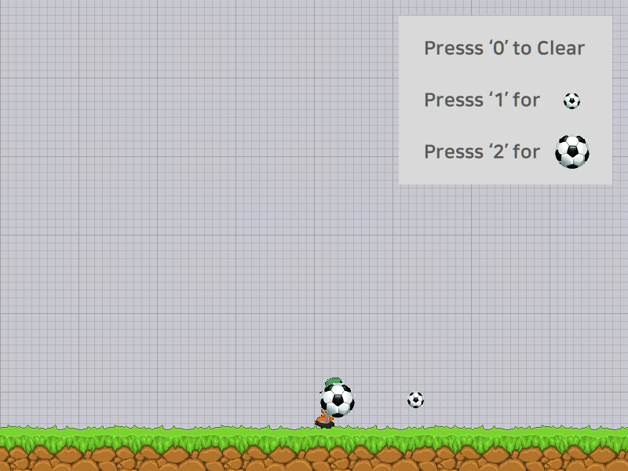

# Drill-13 — 플레이와 함께 동작하는 아이템 모드

`LEC15_Game_Framework` 예제를 복사한 뒤, 게임 진행을 유지하면서 공 발사 옵션을 선택하는 아이템 창을 추가했다. 이 폴더는 기존 Drill-11과 별개의 Git 저장소이다.

## 실행

이 폴더에서 실행한다.

```powershell
python -m pip install -r requirements.txt
python main.py
```

다른 작업 폴더에서도 `main.py`의 경로를 지정하여 실행할 수 있다. 시작 시 소스 폴더에서 이미지 파일을 찾도록 기존 진입점이 구성되어 있다. 로고가 끝난 뒤 타이틀 화면에서 Space를 누르면 플레이를 시작한다.

## 조작

| 입력 | 동작 |
| --- | --- |
| 좌우 방향키 | 소년 이동 |
| Space | 현재 선택에 따라 공 발사. 수면 상태에서는 먼저 깨어남 |
| `i` | 아이템 창 열기 / 닫기 |
| 아이템 창에서 `0` | 이후 공 발사를 해제 |
| 아이템 창에서 `1` | 이후 공을 기본 크기로 발사 |
| 아이템 창에서 `2` | 이후 공을 기본 크기의 2배로 발사 |
| `p` | 기존 일시정지 / 재개 |
| 플레이 중 Escape | 로고 화면으로 복귀 |

아이템 창은 플레이 화면 위에 표시되며, 열린 동안에도 소년과 공의 갱신·이동·발사가 계속된다. 숫자 키 선택은 창이 열린 동안만 적용된다. `0·1·2`를 누르면 선택값을 적용하고 창이 자동으로 닫힌다. `i`로도 닫을 수 있으며, 닫은 뒤에도 선택값은 유지되고 새 게임에서는 기본 크기로 시작한다.

**이미 발사된 공은 선택을 바꾸어도 이미지와 크기를 유지한다.** `0` 역시 기존 공을 지우지 않고 신규 발사만 중단한다. `ball21x21.png`와 `ball41x41.png`를 기본/확대 공에 사용하고, 확대 공의 표시 가로·세로는 기본 공의 정확히 2배로 설정한다.



## 구현 구성

- `item_mode.py`: 창 활성 상태, `i`와 숫자 키 입력, 안내 이미지 및 두 공 이미지 표시.
- `play_mode.py`: 아이템 입력과 플레이 입력을 함께 처리하고, 월드를 그린 다음 아이템 창을 표시한다. 아이템 창을 모드 스택에 넣지 않아 플레이의 `pause()`를 호출하지 않는다.
- `boy.py`: 다음 발사에 사용할 선택값을 관리하며, 해제 상태에서는 새 공을 생성하지 않는다.
- `ball.py`: 생성 시 이미지와 표시 크기를 공 인스턴스에 저장한다.
- `game_framework.py`: 종료 요청 이후 추가 갱신·렌더링을 방지한다.

## 확인 결과

Python 3.11, pico2d 1.5.1, transitions 0.9.3 환경에서 제어된 입력과 창을 표시하지 않는 SDL 렌더링으로 확인했다.

- 아이템 창과 플레이의 동시 진행, 이동 중 창 토글 및 키 해제 처리.
- 기본 크기 / 2배 크기 발사와 `0` 선택 시 신규 발사 중단.
- 선택 변경 전 발사된 공의 이미지·크기 유지와 이동 지속.
- 창 밖 숫자 입력 무시, 닫기·재열기 시 선택 유지.
- 기존 일시정지·재개, 수면 해제, Escape 복귀, 새 게임 초기화.
- 다른 작업 폴더에서 실제 `main.py` 실행, 전체 화면 전환 및 종료.
- 제공된 이미지 로딩과 아이템 창 렌더링 결과 이미지 확인.

원본 복사 상태를 `첫 커밋`으로 기록한 후, 11개의 단계별 개발 커밋을 추가했다. 원본 예제 폴더는 보존했다.
